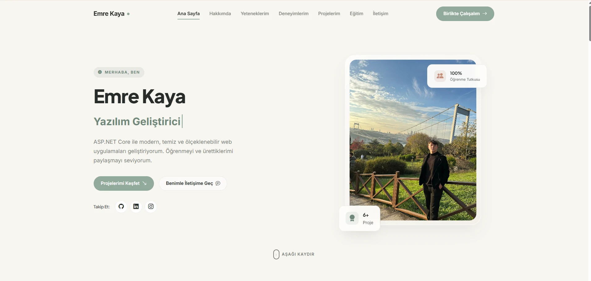
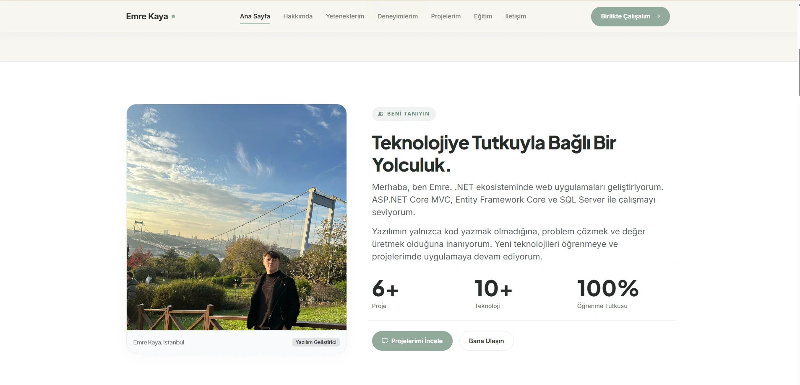
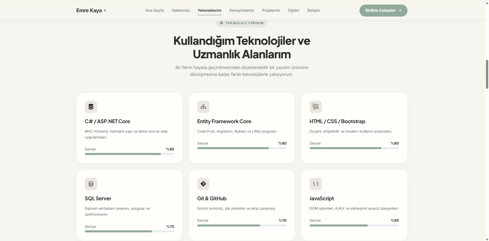
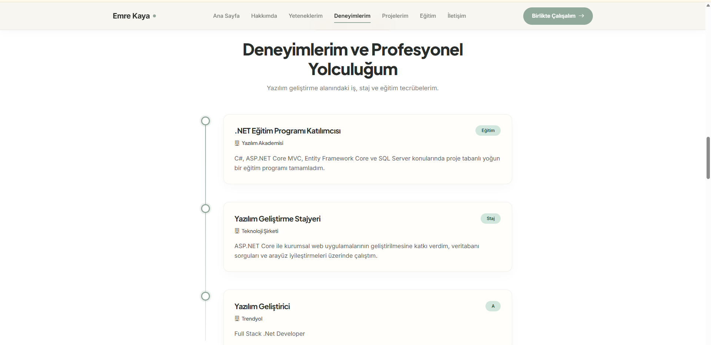
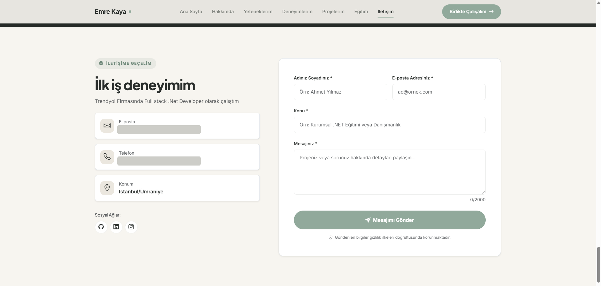
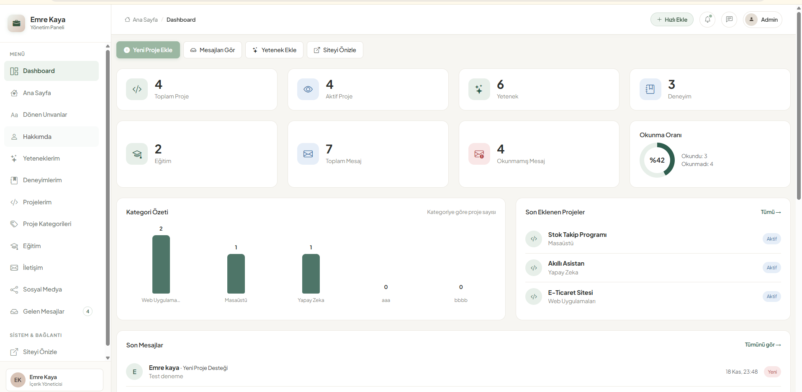
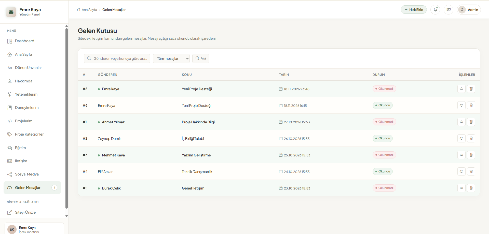
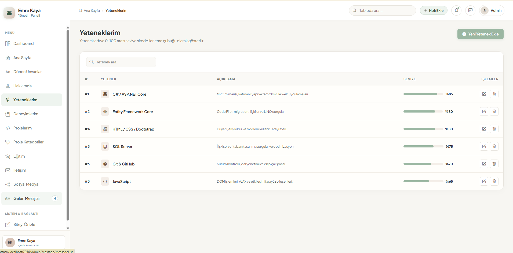

# MyPortfolio — Dinamik Portfolyo Yönetim Sistemi

ASP.NET Core MVC (.NET 9) + Entity Framework Core (Code First, SQL Server) ile geliştirilmiş, tüm içeriği Admin panelinden yönetilen kişisel portfolyo sitesi.

## Kurulum
1. `Documant/Context/PortfolioContext.cs` içindeki bağlantı cümlesini kendi SQL Server adresinize göre düzenleyin.
2. Package Manager Console:
   ```
   Update-Database
   ```
3. Projeyi çalıştırın. Site: `/` — Admin: `/Admin`
4. İlk kullanım sırası: Admin > **Proje Kategorileri** (en az 1) → **Hakkımda / Ana Sayfa** → diğer modüller.

## Modüller
| Modül | Admin | Sitede |
|---|---|---|
| Ana Sayfa (Hero) | Tekil kayıt güncelleme + fotoğraf | Karşılama alanı |
| Dönen Unvanlar | CRUD, sıra, Aktif/Pasif | Ana sayfadaki daktilo animasyonu |
| Hakkımda | Tekil kayıt güncelleme + fotoğraf + 3 öne çıkan bilgi | Hakkımda bölümü, marka adı, footer |
| Yeteneklerim | CRUD, 0-100 seviye | Kart + ilerleme çubuğu |
| Deneyim | CRUD, Aktif/Pasif | Zaman çizgisi (yalnız aktifler) |
| Eğitim | CRUD, sıra numarası | Eğitim bölümü |
| Projelerim | CRUD, görsel yükleme, kategori filtresi, sıralama, Aktif/Pasif | Kart listesi, kategori filtresi, sıralama |
| Proje Kategorileri | CRUD (projesi olan silinemez) | Filtre butonları |
| İletişim / Sosyal Medya | CRUD | İletişim bölümü, hero, footer |
| Gelen Kutusu | Arama, durum filtresi, modal detay, okundu/okunmadı, silme | İletişim formu (AJAX) |
| Dashboard | `DashboardViewModel` ile istatistikler, son 5 mesaj, son 3 proje, kategori özeti | — |

## Teknik notlar
- **İlişki:** `Category (1) — Project (N)`; listelerde `Include`, formda `asp-items` dropdown. Silme `Restrict`.
- **Doğrulama:** Data Annotations + `ModelState.IsValid`; alan bazlı hata mesajları (`asp-validation-for`, public formda JSON hata sözlüğü).
- **Görsel yükleme (`Services/ImageService`):** yalnız JPG/PNG/WEBP, en fazla 2 MB, dosya imzası (magic bytes) kontrolü, GUID dosya adı, DB'de sadece yol. Güncelleme/silmede eski dosya temizlenir.
- **Güvenlik:** tüm POST isteklerinde AntiForgery (global filtre), silme işlemleri POST, public mesaj formunda `[Bind]` ile aşırı gönderim (overposting) engeli.
- **UX:** SweetAlert2 silme onayı ve bildirimleri, tablo içi canlı arama, görsel önizleme, boş durum mesajları.
- **Özgün UX iyileştirmesi:** Dashboard'daki son mesaja tıklayınca Gelen Kutusu ilgili mesajı modalda otomatik açar; mesaj açılınca okundu olur ve sidebar'daki okunmamış sayacı sayfa yenilenmeden güncellenir. Hızlı Ekle menüsü ve zil ikonu okunmamış mesajlara kısayol verir.

## Klasör yapısı
`Entities/` · `Context/` · `Services/` · `Areas/Admin/{Controllers,Models,Views,ViewComponents}` · `ViewCompanents/` (site bileşenleri) · `Views/`

## Ekran Görüntüleri

### Site

**Ana Sayfa**



**Hakkımda**



**Yeteneklerim**



**Deneyimlerim**



**İletişim**



### Admin Paneli

**Dashboard**



**Gelen Kutusu**



**Yetenek Yönetimi**


